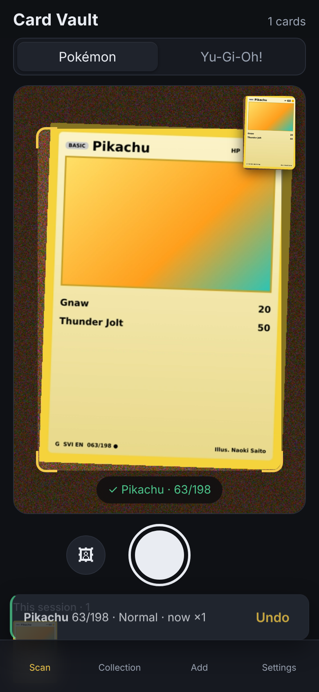
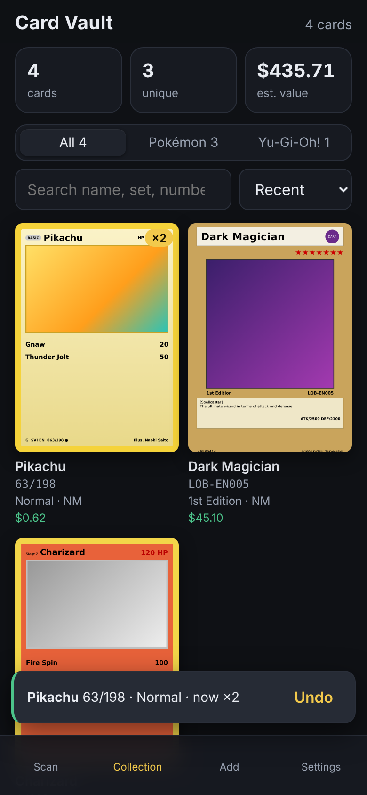

# Card Vault

Scan your trading cards with your phone's camera and they go straight into your collection
database. Pokémon, Yu-Gi-Oh!, Magic: The Gathering and Disney Lorcana are supported. It's a web app: no install, no account, and
your collection stays on your device.

<p>
  
  
</p>

## Running it

```bash
cd cards
npm install
npm run dev          # http://localhost:5174 on this computer
npm run dev:phone    # https://<your-computer's-LAN-IP>:5174 for your phone
npm test             # parser + catalog unit tests
npm run build        # static site in dist/, host anywhere (GitHub Pages, Netlify…)
```

Browsers only open the camera on `https://` pages or `localhost`. `dev:phone` serves HTTPS with
a self-signed certificate, so the first time you open it on your phone you'll need to accept the
warning. If the camera isn't available, the scan button falls back to the phone's photo picker,
which still works over plain HTTP.

## How scanning works

1. Hold the card inside the on-screen frame and tap the shutter (or press **Space** on a computer).
2. The app reads the strips of the card that identify it:
   - **Pokémon**: the name line, plus the collector number and set code at the bottom
     (`SVI EN 063/198`, `4/102`, `TG05/TG30`, `SWSH050`).
   - **Yu-Gi-Oh!**: the name banner, the set code under the artwork (`LOB-EN005`), the
     1st Edition/Limited Edition stamp, and the 8-digit passcode.
   - **Magic**: the name, plus the collector line bottom-left (`0123 R` / `M21 • EN`, or
     `123/269` on 2015–2019 cards).
   - **Lorcana**: the name and version banner, plus `12/204 • EN • 1` bottom-left (number / set
     size, language, set).
3. It looks those up in the card database and ranks the matches, comparing your photo against each
   match's catalog picture. That's how it tells apart printings with the same name, and how it still
   finds the card when glare hides the number.
   One tap reads up to four frames in a row, keeping whatever each frame got right, and says so when
   glare is the problem.
4. **One clear match** (number + set + name agree): the card is added immediately, with an
   **Undo** toast, and the camera stays ready for the next card.
   **Several possible matches** (for example, only the name was readable): you get a short
   list with pictures to pick from.

**Foil / finish.** The catalog knows which finishes each printing exists in (Normal, Holofoil,
Reverse Holofoil, 1st Edition…), so a card that only comes one way is set automatically. When it
could be either, the app looks for the foil speckle that reverse holos have across the card body,
then shows one-tap finish buttons on the "Added" message so a wrong guess is a single tap to fix.
It learns from those taps, since every phone camera sees foil a little differently.

Scanning the same card again increases its quantity. Each copy is tracked by printing,
variant (Holofoil, Reverse Holofoil, 1st Edition…), condition and language, all editable
from the Collection tab.

### Two ways to read a card

| | On-device OCR (default) | AI scan (optional) |
| --- | --- | --- |
| How | [Tesseract](https://github.com/naptha/tesseract.js) in the browser | The photo is sent to Claude, which reads the card |
| Cost | Free | About a cent per scan, on your own [Anthropic API key](https://console.anthropic.com/settings/keys) |
| Privacy | Photo never leaves the phone | Photo goes to api.anthropic.com |
| Good at | Flat, well-lit, non-holo cards | Holo foil, glare, angled shots, non-English cards; detects the game itself |

Turn AI scan on in **Settings**. The key is stored only in your browser.

## Binder: what's left to collect

The **Binder** tab lists every set in the catalog, newest first, with the sets you've started
at the top and a progress bar for each. Open a set to see every card in it as a binder page:
cards you own are in full colour, and the ones you're missing are faded with their collector
number. Tap a faded card to add it. Cards added since you last opened that set flip into colour
with a glint, so after a scanning session you can see exactly what filled in. **Have** / **Need**
filters the page; finishing a set turns its bar gold.

Owning any finish, rarity or condition of a collector number fills that slot.

## Card data

| Game | Source | Prices |
| --- | --- | --- |
| Pokémon | [TCGdex](https://tcgdex.dev), with [pokemontcg.io](https://pokemontcg.io) API v2 as a fallback | TCGplayer market price per finish (Normal / Holofoil / Reverse Holofoil…) |
| Yu-Gi-Oh! | [YGOPRODeck](https://ygoprodeck.com/api-guide/) API v7 | TCGplayer price for that exact printing (set code + rarity) |
| Magic | [Scryfall](https://scryfall.com/docs/api) | TCGplayer price for normal / foil / etched |
| Lorcana | [Lorcast](https://lorcast.com/docs/api) | TCGplayer price for normal / foil |

All are free and need no key. Saved cards' prices refresh automatically once a day when you open
the Collection tab, or on demand with **Update prices**. Prices are TCGplayer market prices for
one ungraded copy. Yu-Gi-Oh! prices don't distinguish 1st Edition from Unlimited, because the
source doesn't.

TCGdex has no TCGplayer price for the Pokémon subsets TCGplayer files as separate groups
(Trainer Gallery, Galarian Gallery, Shiny Vault, Classic Collection, Radiant Collection and a
few others). For those the app takes the same card's TCGplayer price from pokemontcg.io, and
failing that Cardmarket's trend price converted from EUR at the day's rate. The card's detail
sheet says which source a price came from.
Card images are cached in the browser when you add a card, so the collection works offline and
doesn't keep re-downloading images from the catalogs.

## Scan reports

If cards are misread or missed, **Settings → Share scan report** (or the button under "What the
scanner saw") saves the last 20 scans as one file: the photo of each card, what OCR read, the
matches and what happened next (added, picked another match, searched instead). Nothing leaves
the phone unless you share it. It's the quickest way to get a misread fixed.

## Your data

The collection is stored in the browser's IndexedDB on the device you scan with. From the
Collection tab you can:

- **Export CSV**: one row per entry (name, set, number, rarity, variant, condition, language,
  quantity, value) for spreadsheets.
- **Back up (JSON)** / **Restore**: a full backup you can move to another device. Restoring
  merges into what's already there.

## Code map

| Area | Files |
| --- | --- |
| Types | `src/types.ts` |
| OCR regions + text parsing | `src/scan/parse.ts` (pure, unit-tested) |
| Camera, cropping | `src/scan/camera.ts` |
| OCR (adaptive threshold → Tesseract) | `src/scan/ocr.ts` |
| Glare, foil shimmer, photo-vs-catalog matching | `src/scan/vision.ts` |
| AI reader | `src/scan/ai.ts` |
| Scan → candidates | `src/scan/recognize.ts` |
| Catalogs | `src/games/tcgdex.ts`, `pokemon.ts`, `yugioh.ts`, `mtg.ts`, `lorcana.ts`, ranking in `src/games/game.ts` |
| Pokémon set table (codes, sizes, dates) | `src/games/pokemonSets.ts` (generated), `src/games/pokemonSetIndex.ts` |
| Scan reports | `src/scan/scanLog.ts` |
| Set completion (binder) | `src/db/progress.ts` (pure, unit-tested), `src/ui/binderView.ts` |
| Collection DB, export, price refresh | `src/db/store.ts`, `src/db/exchange.ts`, `src/db/prices.ts` |
| UI | `src/ui/*` (no framework), `src/style.css` |

Adding another game (One Piece, Flesh and Blood…) means one new file in `src/games/` that
implements the `Game` interface (OCR regions, a parser, catalog lookup/search, sets for the
binder), plus its entry in `src/games/index.ts` and its artwork / text-box regions in
`src/scan/vision.ts`.

## Checking Pokémon lookups against the whole catalog

`scripts/pokemon-eval.test.ts` replays the text printed on thousands of real cards (every kind:
secret rares, Trainer/Galarian Gallery, Shiny Vault, promos) through the parser and lookup
against a local copy of the TCGdex catalog, and reports how often the right printing comes out
on top, with the name and number read, the number only, or the name only. The same checkout
regenerates the set table:

```bash
git clone --depth 1 --filter=blob:none --sparse https://github.com/tcgdex/cards-database ../cards-database
(cd ../cards-database && git sparse-checkout set --no-cone '/data/*/*.ts' '/data/Scarlet & Violet/' '/data/Mega Evolution/' '/data/Sword & Shield/' '/data/Sun & Moon/')
node scripts/gen-pokemon-sets.mjs ../cards-database
TCGDEX_DIR=../cards-database EVAL_OUT=eval.txt npx vitest run scripts/pokemon-eval.test.ts
```

## Roadmap

- Auto-capture when the card is steady in the frame (no tap needed).
- Card-edge detection so photos don't need to be framed carefully.
- Optional sync between devices (export/import works today).
- Price history and a "what's my collection worth" chart.
- Bulk mode for binders and 9-pocket pages.
